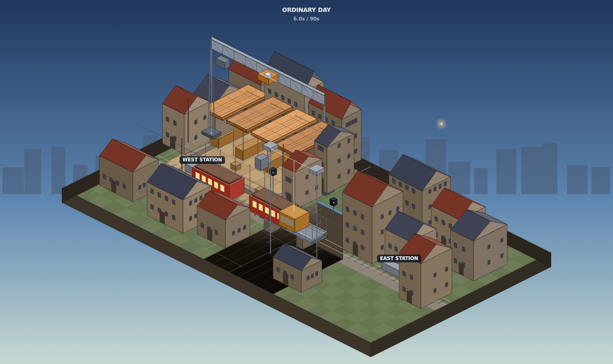
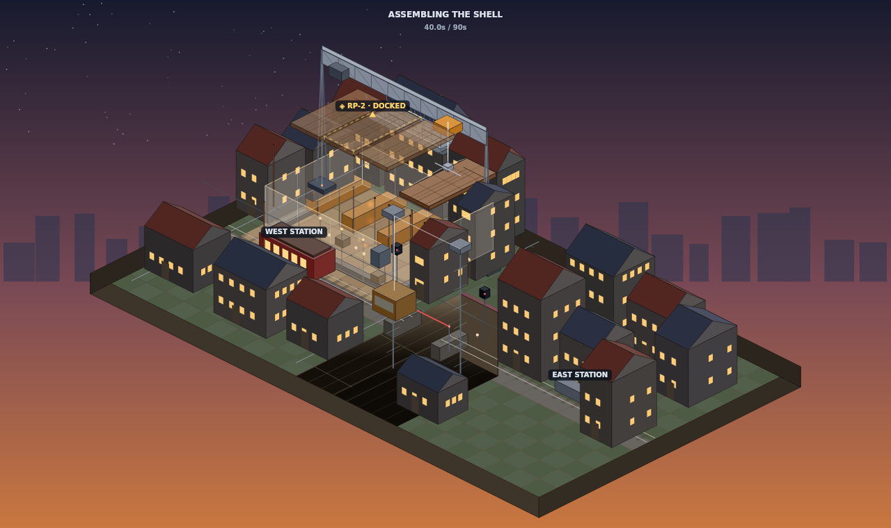
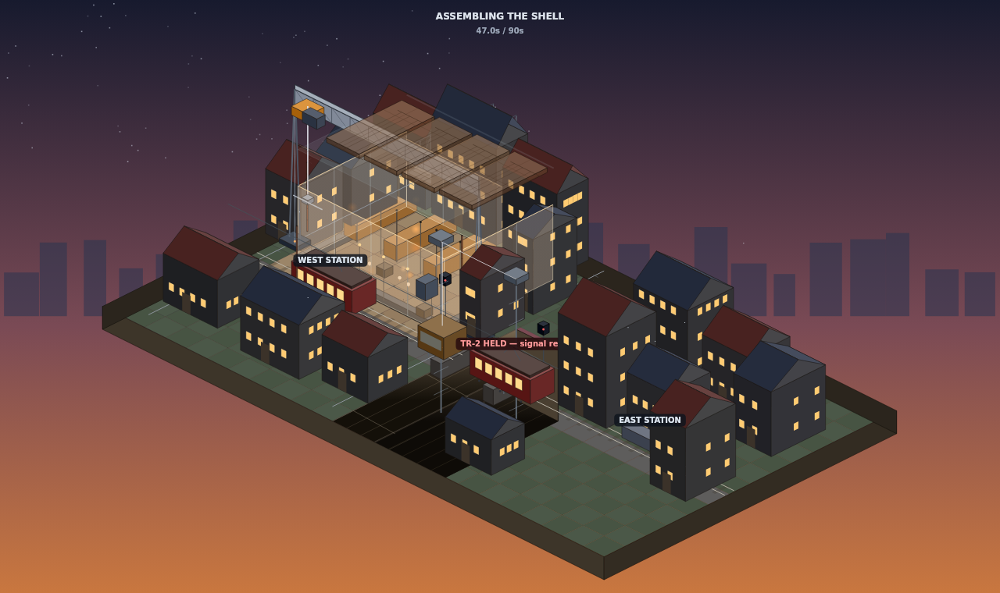

# THE CITY THAT FOLDS AT DUSK

A playable, real-time isometric simulation of one mechanized city block. You get **90 seconds**
between the end of an ordinary day and a lethal cold front (−38 °C). At dusk the block takes
itself apart and rebuilds itself as a sealed thermal shell. Every part is tracked by identity and
drawn at its real position — nothing is swapped for a "finished roof" sprite.



## Run it

No build step, no dependencies, no network calls.

```bash
node server.js          # -> http://localhost:8080   (or: npm start)
```

Or serve the folder any other way (`python3 -m http.server 8080`) — it is plain HTML + JS.

## Controls

| Control | What it does |
| --- | --- |
| **Pause / Play** | Freeze the world (nothing steps, the camera keeps breathing) |
| **Step** | Advance 0.5 s while paused, to inspect a cascade frame by frame |
| **1× / 2×** | Playback rate |
| **Restart** | Replay the current cycle with identical inputs |
| **Cycle selector** | *Cycle 1 · Normal dusk* / *Cycle 2 · Delayed tram* |
| **Tap any module** | Highlights it in the scene and shows load, destination, dependencies, live position |
| **Sound** | Optional mechanical clicks/clanks only — no speech anywhere |

All controls are ≥ 44 px tall and the layout reflows for tablet widths.

## What becomes what

The market is the hero. At the start it is an open-air plaza with four stall canopies.

| Part | Starts as | Ends as |
| --- | --- | --- |
| **RP-1…4** | the four stall canopies on posts | the market ceiling, four bays, docked in order |
| **BR-1** | the steel bridge spanning the ravine | shell rib **RIB-A** on the north wall (rotates 90°, travels west) |
| **CD-1…3** | brick chimney stacks | shell piers with vent louvres on the west / east / south walls |
| **GN-1** | rail-mounted portal crane | stays on its rails, standing by inside the shell |
| **FL-1** | ravine freight lift | stays on its cable, standing by |

Each canopy leaves visible empty post sockets. The bridge leaves a real gap in the ravine crossing
and closes the crossing gates. The ducts leave their chimneys' footings. The shell membrane rises
as modules dock, so by the last seam the market that sat in the wind is a warm amber room.



## The five interlocking systems

1. **Tram + crossings** — TR-1 and TR-2 run the east–west line; the crossing gates and SIG-1/SIG-2
   are driven by the bridge's actual state. TR-2 can only cross while BR-1 is spanning.
2. **People + walking routes** — 20 agents with waypoint routes: market, west houses, east district,
   and the ravine-crossing route that only closes if the bridge is still there. They are tinted by
   exposure and glow warm once sheltered.
3. **Gantry + freight lift** — GN-1 rides two rails, its trolley travels the yard, and it lifts each
   part on a real cable with tension-dependent sag, a counterweight and brake shoes. FL-1 crosses
   the ravine on a catenary cable with its own counterweight.
4. **Reusable structural modules** — 8 parts with persistent identity, position, load and destination.
   The crane's hook is physically attached to whichever part it is moving.
5. **Cold front + shelter heat** — the front sweeps west from t = 52. Interior temperature is a
   function of sealed fraction *and* breach; breach grows while the last seam is open.

Routes, power and shelter all read the **actual** part positions: the seal only completes when all
8 modules report `docked`, and the lift can only load passengers when TR-2 is physically at the platform.

## Cycle 2 — the delayed tram

TR-2 crawls in at 0.18 tiles/s instead of 1.9, so the normal fold order creates a genuine conflict:
the ravine bridge is both the tram's last crossing and a required shell rib.



Three decisions, each with a different consequence in the city:

| Choice | Sheltered | Exposed | Seam | Breach | Interior |
| --- | --- | --- | --- | --- | --- |
| **A · Wait** (hold the bridge) | 38 | 0 | 76.7 s | 36 % | **−6.8 °C** |
| **B · Fold early** (t = 24) | 26 | **12** | 67.3 s | 0 % | 24 °C |
| **C · Divert via freight lift** | 38 | 0 | 67.3 s | 0 % | 24 °C |

Waiting saves the tram but the seam closes 4 s after the front reaches the market, and the interior
drops below freezing. Folding early keeps the shell on time but strands twelve people east of the
ravine. The lift works **only if the route, timing and load allow it**:

* FL-1 must first finish its current freight delivery (it is carrying cargo when the cycle starts).
* It can then load only if TR-2 is physically within 1.6 tiles of the east platform — otherwise the
  loading timer resets.
* It unloads into the shelter only if the cold front has not yet passed the east platform.
  Diverting at t = 60 fails: **LIFT TOO LATE — passengers exposed in transit** (12 exposed).

There is no rescue button. "Divert" hands the lift a mission; the physical preconditions decide the outcome.
The four manual lift buttons (Send / Load / Traverse / Unload) exist for players who want to fly the
rescue by hand, and they refuse illegal commands (e.g. loading while carrying freight).

## Determinism

The simulation uses a fixed timestep (1/60 s), an integer hash per step and a seeded PRNG
(12345 normal / 67890 delayed). `CitySim.hash(sim)` over the final state is identical across runs
with the same inputs — verified in the test suite. Rendering uses randomness only for cosmetic
snowflakes and never feeds back into the simulation.

## Verification record (what was actually run)

Two headless suites plus a rasteriser, all in this repo. Nothing below is aspirational.

```bash
node tests/test.js        # 31 checks — simulation, outcomes, determinism, preconditions
node tests/dom-smoke.js   # 26 checks — real index.html scripts against a DOM/Canvas shim
node tests/shots.js       # renders real frames to shots/*.png (needs @napi-rs/canvas)
```

**`tests/test.js` — 31 passed, 0 failed**

* *Normal dusk*: finishes; all 8 modules docked; BR-1 state `RIB`; seam at 67.3 s; 0 exposed;
  interior 24 °C; label `SEALED WARM`.
* *Late tram / wait*: tram crossed; seam 76.7 s; breach 36 %; 0 exposed.
* *Late tram / fold early*: tram stranded; 12 exposed; breach 0 %.
* *Late tram / lift (t = 5)*: `rescueDone`, 12 rescued, 18 tram passengers sheltered, 0 exposed, breach 0 %.
* *Late tram / lift too late (t = 60)*: rescue fails and 12 are exposed.
* *Distinct outcomes*: wait ≠ early ≠ lift on sheltered/exposed/breach, with 3 distinct final hashes.
* *Determinism*: two identical runs produce the same hash **and** identical metrics; pausing (not
  stepping) leaves the hash unchanged; resuming produces the same state as an uninterrupted run.
* *Preconditions*: loading is refused while the lift carries freight; traversing is refused with no passengers.
* *Tablet*: `max-width: 760px` media query present; 44 px minimum touch targets; canvas responds to
  `getBoundingClientRect`; no `speechSynthesis` and no spider imagery anywhere.

**`tests/dom-smoke.js` — 26 passed, 0 failed.** This executes the *real* `index.html` inline app
script plus `sim.js` and `render.js` against a DOM/Canvas2D shim and drives the actual UI: 500+ draw
ops per second of frames, gradients, text, DPR-scaled canvas; HUD clock and seal counter update;
tapping the canvas selects a module; pause freezes the clock; step advances it; speed toggles to 2×;
switching to the delayed cycle reveals the decisions panel; a chosen strategy disables its button;
a full run reaches the outcome panel with the what-became-what map; restart clears it; resize to
768 × 1024 (DPR 2) still renders.

**Visual verification.** Chromium could not be downloaded in this sandbox, so instead of claiming a
browser screenshot I rasterised the **real renderer** through `@napi-rs/canvas` at 1280 × 760 and
768 × 1024 and inspected the frames: ordinary day, market emptying, bridge unpinning, panels
travelling, cold front, ducts docking, last seam, sealed wide shot, tram held, lift rescue, stranded
tram. Four of those frames are committed in `docs/`. During this pass the rasteriser also caught two
real crashes (`lerp is not defined`, `LIFT_EAST is not defined`) and an invalid gradient
(`rgb(NaN,NaN,7)`), all fixed.

**Server**: `node server.js` serves `index.html`, `src/sim.js`, `src/render.js`, `src/audio.js`
(all HTTP 200) on `0.0.0.0:8080`.

### What is *not* verified

* No real-browser frame was captured, so touch gestures, actual WebAudio output and font metrics on
  physical tablet hardware are unverified. The code paths are exercised headlessly, not visually in a browser.
* The 2× rate and step button were verified through the shim's frame pump, not by hand.

## Files

```
index.html          UI shell, HUD, inspector, decisions, outcome panel, glue
src/sim.js          deterministic core: modules, trams, people, gantry, lift, cold, outcomes, hash
src/render.js       Canvas 2D isometric renderer: depth-sorted, cutaway shell, particles
src/audio.js        optional mechanical WebAudio (no speech)
server.js           zero-dependency static server
tests/test.js       simulation + acceptance tests
tests/dom-smoke.js  runs the real page scripts headlessly
tests/shots.js      renders inspection frames with @napi-rs/canvas
docs/               rendered verification frames
```
